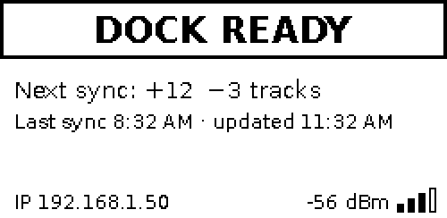
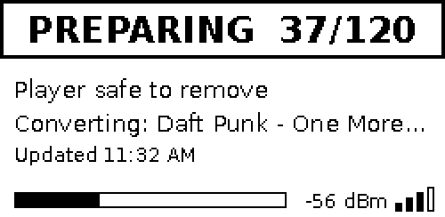
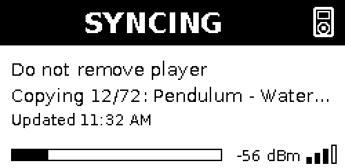
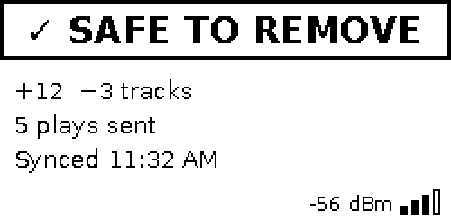
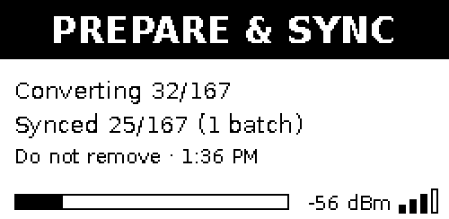
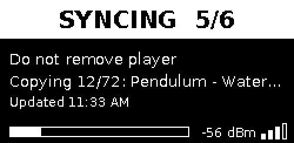

# SongDock

A Raspberry Pi dock that keeps a stock-firmware iPod, a Rockbox player or a
simple music-folder player in sync with a [Navidrome](https://www.navidrome.org/) music server. Plug the iPod in, and
the dock:

1. **Logs what you played** on the iPod to your Navidrome account (play counts
   and "last played"). If the server is offline, plays wait on the dock and are
   sent later. Nothing is lost.
2. **Copies new music** from your Navidrome **Favorites** and/or from any playlist
   you tag with `#ipod`, converted for the iPod (MP3), with album art.
3. **Removes music** that has left those lists.
4. **Keeps your playlists** on the iPod (Favorites plus each tagged playlist).
5. **Charges the iPod**, and shows on its e-ink screen when it's safe to unplug.

Between docks it quietly checks Navidrome every 5 minutes (adjustable) and prepares new
music in the background, so syncs are quick.

**To set one up, follow [INSTALL.md](INSTALL.md).**

---

## Before you start: read these

- **Which iPods work.** It depends on the firmware. On Apple's own
  (stock) firmware, the dock writes the iPod's music database, which newer
  iPods sign in ways the dock can't reproduce. With
  [Rockbox](https://www.rockbox.org/) installed, the dock just copies files,
  but Rockbox itself only runs on some iPods. So Rockbox adds the older
  iPods, but doesn't help the newer nanos.

  | iPod | Stock firmware | Rockbox |
  |---|---|---|
  | iPod nano 4th generation | **Tested** | Rockbox Unsupported |
  | iPod nano 3rd generation | Should work; not tested | Rockbox Unsupported |
  | iPod classic (6th/6.5th/7th generation, 2007-2009) | Should work; not tested | Should work; not tested |
  | iPod video (5th/5.5th generation) | Should work; not tested | Should work; not tested |
  | iPod nano 1st/2nd generation | Should work; not tested | Should work; not tested |
  | iPod photo/color, iPod 4th generation, iPod mini | Not supported | Should work; not tested |
  | iPod 1st-3rd generation (2001-2003) | Not supported | N/A |
  | iPod nano 5th generation and later, iPod shuffle, iPod touch | Not supported | Rockbox Unsupported |

  Rockbox itself decides which iPods it runs on, and its list changes over
  time: check [Rockbox's device status page](https://www.rockbox.org/wiki/TargetStatus)
  for the current, accurate list.

  **Other Rockbox players** (not iPods) should work too, in theory: the
  dock treats any player with a `.rockbox` folder and a `MediaDock.txt` the
  same way. Your mileage may vary: no non-iPod player has been tried, and a
  player that also has a memory card syncs only the drive with Rockbox on
  it. Leaving one docked won't make it sync again by itself when new music
  arrives (that only works for iPods); unplug and replug it.

  **Other music players** (neither an iPod nor Rockbox: cheap MP3 players,
  and players like the SnowSky that just play a folder of music) get the
  basics: a `MediaDock.txt` in the player's top folder opts it in, and the
  dock copies music into a `MediaDock` folder and removes songs that left
  your lists. Songs from tagged playlists are copied too, but into the
  music library only: there are no playlists on the player. These players
  don't keep a play history the dock can read, so **no plays reach
  Navidrome**; SAFE TO REMOVE says "No play count - unsupported". Like
  Rockbox players, they need an unplug and replug to sync new music. Tried
  so far with a USB flash drive standing in for one, not with a real
  player.

  On stock firmware, an unsupported iPod gets **SYNC FAILED** with its
  model name, before anything on it is changed. Rockbox support has been
  tried with a USB flash drive set up like a Rockbox player, but not yet
  with a real one (see "Known limitations").

  **How the two differ in the dock:**

  | | Stock firmware | Rockbox | Other music players |
  |---|---|---|---|
  | How the dock spots it | Apple's firmware folders | its `.rockbox` folder | neither, but a `MediaDock.txt` |
  | Where music goes | the iPod's own music database | files in a `MediaDock` folder (artist/album), with `cover.jpg` art; your other files are left alone | the same as Rockbox |
  | Playlists | in the iPod's database | `.m3u8` files in `Playlists` | none (their songs go in the library) |
  | Plays sent to Navidrome | a play count and the last play's time (earlier plays get estimated times) | every play with its exact time; skips don't count (turn on Rockbox's Last.fm log) | none |
  | Music formats | MP3 (default), ALAC or AAC | the same by default; FLAC, Ogg and Opus as-is on a Rockbox-only dock (below) | the same as Rockbox; `flac = false` if the player can't play FLAC |
  | Browsing by artist/album | built in | turn on Rockbox's database auto-update | up to the player (most read the tags) |
  | Formatting | FAT32 ("Windows format") | FAT32 as well | FAT32 or exFAT, as the player came |

  See "Rockbox players" in INSTALL.md for setting one up.

  **Music format for Rockbox:** by default a Rockbox player gets the same
  files as stock iPods (FLAC converted to MP3, or ALAC if you choose it), so
  one dock serves both kinds. If the dock only serves Rockbox players, you
  can turn stock-iPod compatibility off (`type = "rockbox"` in the
  settings): music is then copied **as it is on the server, FLAC
  included**, lossless and with no conversion. FLAC takes about 2-3 times
  the space on the dock's SD card and the player, and a dock set this way
  doesn't sync music to stock iPods, which can't play FLAC (their plays are
  still read). This can also be switched from a `DockSetup.txt` on a docked
  player (`StockCompatible=no` / `yes`); switching it off is refused while
  any stock iPod still syncs, and a stock iPod can always switch it back on.

  Some players can't play FLAC (many cheap MP3 players). With stock
  compatibility off, `flac = false` in the settings (or `FLAC=no` in a
  `DockSetup.txt`) still converts FLAC, to the same format as for stock
  iPods, while other formats are copied as they are.

- **The iPod must be formatted FAT32 ("Windows format").** An iPod restored
  with Finder/iTunes on a **Mac** is usually formatted for Mac (HFS+), which the
  dock can't write to. Restore it once with iTunes on a **Windows** PC. See
  INSTALL.md, step 1.

- **The dock fills the iPod with *your* music and logs its plays to *your*
  account.** It only touches iPods that opted in with a `MediaDock.txt` file
  (see INSTALL.md). Don't add that file to someone else's iPod unless that's
  what you both want.

- **Music added any other way may be ignored.** Songs the dock didn't add are
  left alone, but don't sync the iPod with Finder/iTunes after setting up the
  dock: that replaces the whole iPod database, including the dock's music.

- **The dock keeps a copy of the songs it syncs** (about 2 MB per minute of
  music); a 64 GB card holds roughly 35-40 GB. A bigger iPod fills over
  several syncs: once the card is full, the dock drops its copies of songs
  already on the iPod to make room for the rest. (Built and tested in
  software; not yet tried with a real iPod bigger than the card.)

## Which Raspberry Pi

Both the **Pi Zero W** (first generation) and the **Pi Zero 2 W** run the
dock. Both have 512 MB of memory and 2.4 GHz-only Wi-Fi, and the dock works
out how many songs to convert at once each time it runs.

Measured on the real hardware (FLAC music converted to MP3 V0), each on the
operating system it was tested with:

| | Pi Zero W - 32-bit OS | Pi Zero 2 W - 64-bit OS |
|---|---|---|
| Processor | 1 core | 4 cores |
| Songs converted at once | 1 | 3 (one core is left free for syncing) |
| Time to convert music | a little under 1 minute per minute of music | **3.7 seconds per minute of music** (16 minutes of music per minute) |
| Preparing a first batch of ~900 songs (~2,600 minutes of music) | about 1.5-2 days | **about 3 hours** |
| A weekly handful of new songs (~30) | about 1.5 hours | 5-10 minutes |
| Copying to an iPod nano 4G | ~11 s per song (~1.3-1.5 MB/s; about half of it is the Pi updating the iPod's database and album art) | **~2.8 s per song, ~2.2 MB/s** (902 songs, 5.4 GB, in 41 minutes) |
| When copying happens | **after** all the music is converted, so it adds its own time (one core can't do both) | **during** conversion, every 25 finished songs (`sync_batch_size`), so it isn't extra time: in a 73-song test the iPod was complete 1¼ minutes after the last song converted* |
| Temperature while converting | no throttling seen | ~50 °C with a small heatsink, never throttled |

**Which to get:** the **Pi Zero 2 W** is about 16 times faster at preparing
music, which matters for the first fill of an iPod, for big libraries, and
after changing the music format (everything is converted again). Day to
day - a few new songs a week - a Pi Zero W keeps up fine; songs that are
already MP3 or AAC on the server need no conversion on either.

\* Verified on a Pi Zero 2 W with an iPod nano 4G: three batch syncs ran
alongside three conversions with memory to spare. (An earlier version ran
the Pi out of memory, until the iPod's album art was stored once per album
and the sync's memory use was cut.) Most of the Zero W's 11 seconds per
song was the processor (updating the iPod's database and album art), not
the USB link.

For a very large library (200 GB of FLAC): the Pi Zero 2 W converts it in
about a day and a half and copies it (about a day at ~2.2 MB/s) at the same
time, batch by batch, so the whole fill takes about a day and a half. On a
Zero W: about 20 days of conversion, then ~40 hours of copying.

**Have a Pwnagotchi you no longer use?** It's usually the same hardware:
a Pi Zero W or Zero 2 W with a Waveshare 2.13" e-Paper HAT, so it can
become a SongDock. Check the version printed on the back of the screen:
**V4** is the tested one; **V3** and **V2** work too (set `[display] model`;
untested on real screens so far), and a V2 does a full refresh - a brief
flash - on every update.

**32-bit or 64-bit Raspberry Pi OS:**
- The **Pi Zero W can only run the 32-bit** version (its processor has no
  64-bit mode). The Pi Zero 2 W runs either; the dock is tested on it with
  **64-bit**.
- A **32-bit** SD card works in both Pis, so you can move it from a Zero W
  to a Zero 2 W later without reinstalling. A **64-bit** card only starts
  on the Zero 2 W.
- Part of the Zero 2 W's speed may come from the 64-bit OS (the 32-bit one
  is built for the Zero W's older processor, even on a Zero 2 W) rather
  than from its extra cores alone; that hasn't been measured separately.
- On 64-bit, each conversion thread can hold far more memory by default,
  which ran a Zero 2 W out of memory before the dock learned to limit it
  (fixed; it now stays around 75-150 MB while converting).

## What the screen means

| | |
|---|---|
|  |  |
|  |  |

While new music is still converting and a docked iPod is already copying
the first batches (Pi Zero 2 W), both show at once, with one bar for the
whole job:



Every screen shows the time it was drawn, the Wi-Fi signal, and (when
idle) the dock's IP address. With dark mode on (`[display] theme = "dark"`,
for a dark case):



| Screen | Meaning |
|---|---|
| **STARTING UP...** | The dock is booting: waiting for Wi-Fi and the clock |
| **DOCK READY** | Idle. Shows what the next sync will do ("Next sync: +12 -3 tracks" or "iPod is up to date") |
| **PREPARING 3/12** | Downloading and converting new music. The iPod is safe to unplug |
| **SYNCING 5/6** | **Don't unplug.** Reading plays, copying music. The bar shows progress within the current step |
| **PREPARE & SYNC** | **Don't unplug.** New music is still converting while the first batches copy to the iPod (Pi Zero 2 W). Shows both counts; the bar covers both |
| **SAFE TO REMOVE** | Done: tracks added/removed and plays sent. Unplug whenever you like |
| **SYNC FAILED** | Something went wrong; the iPod was put back the way it was. Safe to unplug. See the log |
| **NOT SYNCED** | The iPod has no `MediaDock.txt`, or it isn't an iPod. Nothing was read or changed |
| **WI-FI CHANGED / UNCHANGED** | Result of a `wifi.txt` on the iPod (see INSTALL.md) |
| **DOCK UPDATED / SETUP NOT USED** | Result of a `DockSetup.txt` on the iPod (see `MediaDock README.txt` on the iPod) |
| **NO WI-FI / CLOCK NOT SET** | The dock can't reach the network after starting up |
| **USB NOT WORKING** | A plug-in failed (e.g. a loose connector) and the dock's USB port stopped responding. Unplug the dock's power briefly to restart it; until then, players aren't noticed |

After a sync, the screen goes back to DOCK READY when you unplug the iPod, or
after 10 minutes.

## Checking on the dock

The screen is kept simple on purpose. For the full picture (what the dock is
doing now, time left on a batch of conversions, the last syncs, plays waiting
to be sent, disk space, temperature and any problems), run on the Pi:

```sh
musicdock-status                       # last 24 hours
musicdock-status --since "3 days ago"
```

or from your computer, in one go: `ssh yourname@musicdock.local musicdock-status`
(or `./status.sh yourname@musicdock.local` from this folder on a Mac or Linux).
It only reads; it never changes anything.

## Settings

All settings are in `~/.config/musicdock/config.toml` on the Pi. See
[`config.example.toml`](config.example.toml) for every option with
explanations: which lists to sync, MP3 quality, how long removed songs stay
cached, dark mode, and more.

## Known limitations

This is an early release, built and used with one iPod. What hasn't been
proven yet:

**Tested on real hardware:** an iPod nano 4th generation on a Pi Zero W and
a Pi Zero 2 W, with a Navidrome server. Everything else below is either
untested on hardware or not built.

- **Other iPods are untested.** On stock firmware, the iPod classic, iPod
  video and iPod nano 1st-3rd generation should work but haven't been
  tried; with Rockbox, so should the iPod photo/color, 4th generation and
  mini (see the table above). Newer nanos, the iPod touch and the shuffle
  work with neither.
- **Rockbox support is untested on a real player.** A USB flash drive set
  up like one got its music, covers and playlists as expected, but reading
  plays from Rockbox's log hasn't run on a real player. The other unknown
  is how a Rockbox player identifies itself over USB: if the dock can't
  identify it, the sync stops with "Can't identify the player" before
  changing anything.
- **Other music players are untested with a real player** (a USB flash
  drive standing in for one worked), and the dock can't read their plays
  at all. A player that shows up as two drives
  (built-in memory and a memory card) syncs only the drive with
  `MediaDock.txt` on it.
- **iPods bigger than the dock's storage** fill over several syncs. This is
  built and tested in software, but hasn't run on a real iPod bigger than
  the SD card.
- **Navidrome only, one library per dock.** Other Subsonic-compatible
  servers may work but aren't tested. Several addresses for the same server
  (e.g. at home and away) are fine; combining several servers' libraries
  isn't supported.
- **Play times from a stock iPod are partly estimated.** The iPod only
  records how many times a song was played and when it was *last* played,
  so earlier plays since the last sync get estimated times. The dock's time
  zone must match the iPod's clock. Rockbox records every play's real time.
- **Plays since the last sync are lost if the iPod is wiped or restored**
  before it's docked again. Everything already synced is safe.
- **Mac-formatted iPods can't receive music.** The dock reads their plays,
  then asks for a restore to Windows format (FAT32), which erases the iPod.
- **Don't mix the dock with Finder, iTunes or Apple Music** on the same
  iPod: they replace its whole music database, including the dock's songs.
- **Anyone who can dock an opted-in iPod can reconfigure the dock** with
  `wifi.txt` or `DockSetup.txt` (Wi-Fi, server, what syncs). Fine at home;
  think about it before lending a dock. Opt-in iPods are the ones with
  `MediaDock.txt`.
- **Hardware is specific:** the Waveshare 2.13" e-Paper HAT (V4 tested;
  V3 and V2 supported but untested on real screens),
  2.4 GHz Wi-Fi only (both Pi Zero models), and FAT32-formatted iPods.
- **Not built yet:** marking songs to keep from the iPod (a "keep" list),
  and a progress screen for a multi-day rebuild of a very large iPod.
- **Cosmetic:** on the iPod nano, album art can replace the icons of the
  built-in games.
- **Restart the iPod once after its album art is converted.** The dock
  stores one cover per album rather than one per song (about 12 times
  less space). The first sync after updating converts the art already on
  the iPod; straight after it, the iPod showed no album art and froze when
  a song played, until it was restarted (hold **Menu** and the **center
  button** until the Apple logo appears). After that everything worked.

## Legal notes

- **Not affiliated with Apple.** SongDock is an independent project, not
  affiliated with, endorsed by, or sponsored by Apple Inc. iPod, iTunes,
  Finder and Apple Music are trademarks of Apple Inc., used here only to say
  which devices and software the dock works with. Rockbox and Navidrome are
  the names of their respective projects.
- **Your own music, on your own devices.** The dock copies music from your
  Navidrome server to iPods you've opted in. It's meant for music you have
  the right to use and copy. It doesn't remove copy protection (DRM) and
  can't play or copy protected purchases. Putting your library on other
  people's iPods may not be allowed where you live; that's up to you.

## Related projects

- [iOpenPod](https://github.com/TheRealSavi/iOpenPod): an open-source
  desktop app for managing an iPod without iTunes, syncing music from a
  folder on your computer. SongDock instead keeps an iPod in step with a
  Navidrome server, hands-off, from a dock.

## License

SongDock is released under the [MIT License](LICENSE): free to use,
change and share, as long as the copyright notice stays with it. It comes
with no warranty. The libraries it installs keep their own licenses (below).

## Credits

- iPod database handling: [pygpod](https://github.com/Bionded/pygpod) (LGPL-2.1)
- Tags and album art: [mutagen](https://github.com/quodlibet/mutagen) (GPL-2.0-or-later),
  [Pillow](https://python-pillow.org/)
- E-ink display driver: Waveshare (MIT), bundled in `vendor/`; GPIO via gpiozero (BSD)
- Conversion: ffmpeg with LAME (run as a separate program)
